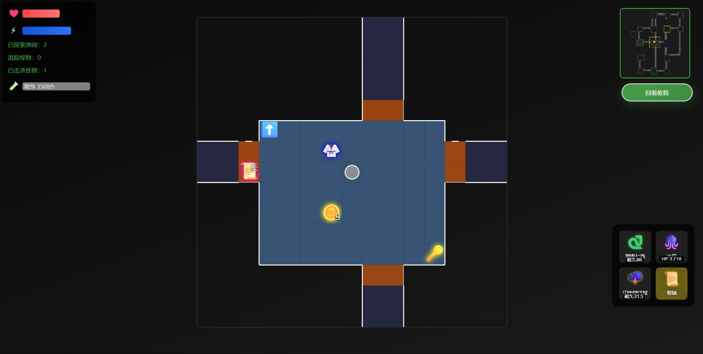

# Chinese Dungeon - Modern Modular Edition

A browser-based dungeon adventure game. Immerse yourself in a stylized dungeon experience with beautiful UI, interactive controls, and engaging gameplay — now with a **modern, modular, maintainable architecture**.



## ✨ What's New in v2.0 (Modular Refactor)

This refactor transforms the original 68k-line monolithic HTML file into a modern ES module project:

- **🏗️ Modular Architecture**: Split into 50+ ES modules organized by domain
- **⚡ Vite Build**: Fast dev server, optimized production builds, HMR
- **🎨 Modular CSS**: 15+ stylesheets (variables, base, HUD, inventory, dialogs, etc.)
- **📦 State Management**: Centralized `gameState` replaces scattered globals
- **🧩 Decoupled Systems**: Renderer, Input, Audio, Inventory, Combat as independent classes
- **🔧 Tooling**: ESLint, Prettier, npm scripts
- **🌉 Legacy Bridge**: Incremental migration path — new and old code coexist
- **📚 Documentation**: Architecture guide + JSDoc

## Features

- **Modern UI**: Stylish menus, animated transitions, responsive design
- **Dungeon Gameplay**: Explore 15+ levels, fight 50+ monsters, collect 100+ items
- **Inventory System**: Manage items with interactive popup & equipment pages
- **HUD**: Real-time health, power, minimap, monster indicators
- **Map Systems**: Default rooms, cave (cellular automata), maze (growing tree), puzzle (Sokoban)
- **Special Floors**: Boss, library, Minotaur maze
- **Pet System**: Recruit pets with equipment & leveling
- **Fusion & Enchant**: Craft and upgrade items
- **Editor**: Full map editor with brush, bucket, wrench rules
- **Workshop**: Supabase-backed level sharing
- **Multiplayer**: Socket.io based coop (experimental)
- **Touch & Keyboard**: On-screen D-pad + configurable hotkeys
- **Visual Effects**: Particle background, damage float, collection pulse
- **Themes**: Default dark + commandline ASCII mode

## 🚀 Quick Start (Modern)

### Development

```bash
# Install dependencies
npm install

# Start dev server (http://localhost:3000)
npm run dev

# Build for production
npm run build

# Preview production build
npm run preview

# Lint
npm run lint
```

### Legacy (No Build)

Simply open `ChineseDungeon.html` in browser — still works for quick play, but deprecated.

New recommended entry is `index.html` served via Vite.

## 🎮 Controls

- **Arrow Keys / WASD / On-screen D-pad**: Move
- **E / Interact Button / Middle Click**: Interact with NPCs/items
- **B**: Backpack
- **H**: Toggle HUD mode
- **T**: Teleport menu
- **P**: Recipe book
- **1-7**: Equipment slots
- **Q/W**: Equipment page prev/next
- **Click Map**: Auto pathfinding
- **Mouse Wheel**: Adjust brush size (in editor) or camera zoom

## 📁 Project Structure

```
Chinese-Dungeon/
├── index.html                # Modern entry (Vite)
├── ChineseDungeon.html       # Legacy monolith (preserved)
├── ChineseDungeon-Viewer.html # Map viewer (legacy)
├── LevelManager.html         # Level manager (legacy)
├── package.json              # Dependencies & scripts
├── vite.config.js            # Vite config + path aliases
├── public/                   # Static assets
├── src/
│   ├── main.js               # Entry - imports CSS & app
│   ├── app.js                # GameApp orchestrator
│   ├── styles/               # Modular CSS (15 files)
│   │   ├── main.css
│   │   ├── variables.css
│   │   ├── base.css
│   │   ├── canvas.css
│   │   ├── menu.css
│   │   ├── hud.css
│   │   ├── inventory.css
│   │   └── ...
│   ├── core/                 # Core constants, config, state
│   ├── engine/               # Renderer, Input, Loop, Audio
│   ├── map/                  # Dungeon & generators
│   ├── entities/             # Items, Monsters, Pets
│   ├── systems/              # Inventory, Combat, Save, etc.
│   ├── ui/                   # HUD, Menus, Dialogs
│   ├── utils/                # Helpers, Icon, Pathfinding
│   ├── data/                 # Item/Monster pools, Recipes
│   └── legacy/               # Bridge for migration
├── docs/
│   └── ARCHITECTURE.md       # Detailed architecture doc
└── dist/                     # Build output
```

See [docs/ARCHITECTURE.md](docs/ARCHITECTURE.md) for full details.

## 🔧 Migration Guide (For Contributors)

### Old Way (Avoid)

```js
// Global variable soup in ChineseDungeon.html
let 地牢 = [];
let 玩家 = {x:0,y:0};
function 生成地牢() { ... }
```

### New Way (Preferred)

```js
// src/map/dungeon.js
import { Dungeon } from '@map/dungeon.js';
import { gameState } from '@core/gameState.js';

export class DefaultGenerator { ... }

// src/core/gameState.js
import { GameState } from './gameState.js';
export const gameState = new GameState();
```

### Adding a New Item

1. Create class in `src/entities/items/`
2. Export from `src/entities/items/index.js`
3. Add to `src/data/itemPool.js`
4. Icon mapping in `src/utils/icon.js` if needed

### Adding a New System

1. Create `src/systems/mySystem.js` with class
2. Inject `gameState` dependency
3. Register in `src/app.js`

## 🧪 Tooling

- **Linter**: `npm run lint` (ESLint with browser + ES2022)
- **Formatter**: Prettier configured
- **Build**: Vite with rollup, aliases `@core`, `@engine`, etc.
- **Compat**: Legacy bridge ensures old saves still load

## 📦 Dependencies

- **Runtime**: `gsap@3.12.5` (animations), `@supabase/supabase-js@2` (workshop)
- **Dev**: `vite@5`, `eslint@8`, `prettier@3`

No heavy frameworks — pure vanilla JS with modern modules.

## 🤝 Contributing

1. Read `docs/ARCHITECTURE.md`
2. `npm install && npm run dev`
3. Create feature branch
4. Follow modular patterns (no new globals!)
5. Submit PR

## 📄 License

[GPL-3.0](LICENSE)  
© SUSTechHSAS

## 🙏 Credits

- Emoji: [AppleColorEmoji](https://github.com/GORAlexComp/AppleColorEmojiFont/releases) + emoji-cdn
- Original game by SUSTechHSAS
- Modern refactor maintains all original gameplay while enabling future growth
